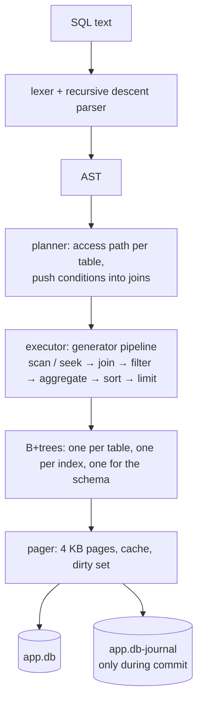

# cinder

[](https://github.com/servanklc93-cmd/cinder/actions/workflows/test.yml)


A SQL database in pure Python, written from scratch: B+trees in a single file, a query
planner that picks indexes, and transactions that survive a crash in the middle of a commit.
There are no dependencies.

Its behaviour is checked against SQLite. Thousands of random queries run on both engines,
and the results have to match exactly.


```python
import cinder

db = cinder.connect("shop.db")
db.execute("CREATE TABLE users (id INTEGER PRIMARY KEY, email TEXT UNIQUE NOT NULL, age INTEGER)")
db.execute("CREATE INDEX users_age ON users (age)")
db.execute("INSERT INTO users (email, age) VALUES (?, ?), (?, ?)", ["ada@x.io", 36, "alan@x.io", 41])

for row in db.execute("SELECT email FROM users WHERE age > ? ORDER BY age", [30]):
    print(row)
```

## What it does

- **SQL:** `CREATE TABLE` / `INDEX` (including `UNIQUE`), `DROP`, `INSERT` (multi-row),
  `SELECT` with `WHERE`, inner, `LEFT` and cross joins, `GROUP BY` / `HAVING`, `DISTINCT`,
  `ORDER BY`, `LIMIT` / `OFFSET`, plus `UPDATE`, `DELETE`, `CASE`, `LIKE`, `IN`, `BETWEEN`,
  `IS NULL`, 20 scalar functions and 7 aggregates.
- **Constraints:** `PRIMARY KEY`, `UNIQUE`, `NOT NULL`, `DEFAULT`, and strict column types
  (the same rules as SQLite `STRICT` tables).
- **Transactions:** `BEGIN` / `COMMIT` / `ROLLBACK`. Outside a transaction every statement
  commits on its own. Inside one, a failing statement is undone on its own and the rest
  stays, as in SQLite.
- **Crash safety:** a rollback journal and fsyncs. Killing the process partway through
  `COMMIT` leaves either the old database or the new one, never a mix.
- **Query planner:** rowid lookups, index lookups, range scans, index nested loop joins,
  and `ORDER BY` satisfied straight from an index. `EXPLAIN` shows the plan.
- **Tooling:** a `sqlite3`-style shell with `.tables`, `.schema`, `.indexes` and `.timer`,
  and `VACUUM` to compact the file.
- **Safety:** `?` parameters (never string-pasted into the SQL), an exclusive file lock so a
  second process can't corrupt the file, and limits that turn absurd input into errors.

## How it works



### The file

The file is a sequence of 4 KB pages. Page 0 is a header (magic bytes, page count, the head
of the free page list and the root of the schema tree). Every other page is a B+tree node
or a free page.

```
leaf node:      kind | count | next leaf  | (keylen, vallen, key, value) ...
interior node:  kind | count | right-most child | (child, keylen, key) ...
```

The B+tree only ever compares raw bytes, and knows nothing about SQL types. Tables are
keyed by rowid. An index is a tree whose keys are `(column value, rowid)` with empty values.
The schema is a tree too. Like SQLite, it stores each table's original `CREATE` statement
and parses it again when the file is opened.

### Keys that sort as bytes

A single B+tree can serve tables and indexes because values are encoded so that comparing
the bytes gives SQL order:

```
NULL     01
number   02 | IEEE double with the sign bit flipped (negatives: all bits flipped) | exact int64 tiebreak
text     03 | UTF-8 with 00 escaped as 00 FF | 00 00
```

The tag byte makes NULL sort before numbers and numbers before text, the same as SQLite.
Integers and reals share the numeric tag, so `1 = 1.0` holds and an index on a `REAL`
column works with an integer literal. A property test sorts 20,000 random values both
ways and checks that the orders agree.

### Commit

Changes stay in memory until commit, which follows SQLite's rollback-journal protocol:

1. copy the original version of every page about to be overwritten into `app.db-journal`,
   then fsync it
2. write the new pages into `app.db`, then fsync it
3. delete the journal. Deleting it is the commit point.

If a process opens the file and finds a journal, the previous commit didn't finish.
The originals get copied back before anything else happens. The crash tests kill a real
process (`os._exit`) after 1, 4 or 12 pages of a commit that moves money between two
accounts, then reopen the file and check that both balances are untouched.

### Statement rollback inside a transaction

Each statement inside `BEGIN ... COMMIT` gets a savepoint. The first version copied
every dirty page when each statement started. That made a long transaction quadratic,
because 40,000 inserts in one transaction took 20 seconds. Savepoints are now
copy-on-write: a page is saved the first time the statement touches it.

### Planning

For each table the planner looks for *search arguments*, conditions of the form
`column <op> expression` where the expression can be computed before the table is read.
It then picks the cheapest access path:

| access path | example |
|---|---|
| rowid lookup | `WHERE id = ?` on an `INTEGER PRIMARY KEY` |
| index lookup (unique first) | `WHERE email = ?` |
| rowid range | `WHERE id BETWEEN 10 AND 20` |
| index range | `WHERE age > 40` |
| full scan | anything else |

`WHERE` conditions move down to the earliest table in the join that has all the
columns they need, and an inner join's `ON` is treated the same way. For the inner table
of a join, "computed before the table is read" includes columns of the outer table. That
is how `ON o.user_id = u.id` becomes an index lookup for every user row
(an index nested loop):

```
cinder> EXPLAIN SELECT * FROM users u JOIN orders o ON o.user_id = u.id WHERE u.email = 'x';
SEARCH users USING INDEX sqlite_autoindex_users_1 (email='x')
  SEARCH orders USING INDEX orders_user (user_id=u.id)  -- for each row above
```

(The real output also lists the filter applied at each step; it's trimmed here.)

The conditions used for a seek are still applied as a filter afterwards, so a seek only
has to return a superset of the right rows. Type edge cases, such as an `INTEGER` column
compared with `2.5`, therefore can't produce wrong results.

`ORDER BY indexed_column LIMIT n` reads the index in order and stops after `n` rows,
without sorting.

Expressions are compiled once into Python closures, instead of walking the AST for
every row.

## Testing

```bash
pip install -e ".[dev]"
pytest      # 122 tests, ~8 seconds
```

**Differential testing against SQLite.** The same schema and random data go into cinder
and into SQLite (with `STRICT` tables so the typing rules line up). Then 3,000 random
`SELECT`s run on both: joins, left joins, `GROUP BY`, `HAVING`, `DISTINCT`, `LIKE`, `IN`
with NULLs, `BETWEEN`, `CASE`, arithmetic, and `ORDER BY ... LIMIT`. So do 2,400 random
writes, half of them inside one big transaction where some statements are made to fail
partway through. Results have to match value for value and type for type.

To check that this test can actually fail, eight bugs were planted in the code one at a
time, for example a case-sensitive `LIKE`, floor division instead of truncation,
`NULL = NULL` returning false instead of NULL, a `LEFT JOIN` dropping unmatched rows, and a
broken statement rollback. The differential tests caught all eight.

Writing them also pinned down several SQLite behaviours that differ from Python:
`-7 / 2` is `-3`, `5.5 % 2` is `1.0`, `round(2.5)` is `3.0`, `LIKE` is case-insensitive
for ASCII only, and `3 IN (1, NULL)` is NULL, not false.

**Other tests:**
- the B+tree against a Python `dict` over 30,000 random inserts and deletes, checking the
  invariants (sorted keys, separator ranges, equal leaf depth, leaf chain) as it goes
- crash recovery in a real killed process, and a torn journal
- hostile input: 5,000 `AND`s in a `WHERE` (works), 5,000 nested parentheses and a
  100,000-term sum (clean errors). These crashed with `RecursionError` in the first
  version, so `AND`/`OR` chains are now flattened and tree walks are iterative.
- a second process trying to open a locked file

## Performance

`python bench/run.py`, the same workloads on the same laptop, both engines on disk and
fsyncing on commit:

| workload | SQLite | cinder | |
|---|---:|---:|---:|
| 100 inserts, each its own commit (fsync) | 23 ms | 29 ms | 1.3x |
| 5,000 lookups by primary key | 20 ms | 81 ms | 4x |
| 2,000 lookups by unique index | 8 ms | 38 ms | 5x |
| 200 × `ORDER BY` indexed column `LIMIT 10` | 1.2 ms | 6.9 ms | 6x |
| `GROUP BY` over 20,000 rows | 4 ms | 32 ms | 8x |
| join + `GROUP BY` (index nested loop) | 1.3 ms | 15 ms | 11x |
| 40,000 inserts in one transaction | 56 ms | 3.2 s | 57x |
| 20 index range scans, ~1,700 rows each | 0.6 ms | 93 ms | 168x |

When each commit fsyncs, the disk dominates and the two are close. Everywhere else
SQLite is a C library with twenty years of tuning, and cinder is Python. The point of
the comparison is to see where the gap grows. Range scans are the worst case: each index
entry costs a separate lookup in the table tree, and SQLite's covering indexes avoid
that work.

Getting here took four measured changes, each of them a 6-20x win on some workload:

| change | 40k inserts | PK lookups | range scans | join |
|---|---:|---:|---:|---:|
| first version | 20.1 s | 480 ms | 1,588 ms | 288 ms |
| copy-on-write savepoints, a parse cache for repeated SQL, a cache of parsed B+tree nodes, and append-friendly leaf splits | 3.2 s | 81 ms | 93 ms | 15 ms |

The last of those changes deals with leaves that overflow from an append, for example
autoincrement ids arriving in order. Those leaves now split at the end instead of the
middle, so pages fill up instead of staying half empty. On the benchmark the file shrank
from 6.9 MB to 4.9 MB. That's still 2.7x SQLite's file (2.1x after `VACUUM`), because
cinder stores integers as fixed 8 bytes where SQLite uses varints.

## SQL reference

| | |
|---|---|
| types | `INTEGER` (`INT`, `BOOLEAN`, ...), `REAL` (`FLOAT`, `DOUBLE`), `TEXT` (`VARCHAR(n)`, ...) |
| column constraints | `PRIMARY KEY`, `NOT NULL`, `UNIQUE`, `DEFAULT <literal>` |
| operators | `+ - * / %`, `\|\|`, `= != <> < <= > >=`, `AND OR NOT`, `IS [NOT] NULL`, `[NOT] IN (...)`, `[NOT] LIKE`, `[NOT] BETWEEN`, `CASE` |
| scalar functions | `length upper lower abs round substr instr replace trim ltrim rtrim coalesce ifnull nullif typeof char unicode min max` |
| aggregates | `count(*) count(x) count(DISTINCT x) sum avg total min max group_concat` |
| statements | `SELECT INSERT UPDATE DELETE CREATE TABLE/INDEX DROP TABLE/INDEX BEGIN COMMIT ROLLBACK EXPLAIN VACUUM` |

## Limits and things it doesn't do

- **One process at a time.** The file is locked exclusively while open; there is no
  shared-reader mode.
- No subqueries, `UNION`, views, `ALTER TABLE`, multi-column indexes or covering indexes.
- A row (and an index key) has to fit in about 1 KB, because there are no overflow pages.
- Deletes don't merge underfull B+tree nodes. Freed space gets reused, and `VACUUM`
  compacts the file.
- Comparisons don't do SQLite's type-affinity conversions (`text_column = 5` doesn't turn
  5 into `'5'`).
- Expressions can nest 64 levels deep.

## Project layout

```
cinder/
  pager.py       pages, cache, rollback journal, savepoints, file lock
  btree.py       B+tree over byte keys
  keys.py        order-preserving key encoding, row format
  catalog.py     tables, indexes, the schema tree
  sql/           lexer, AST, parser
  expr.py        name resolution, expression compiler
  query.py       planner, access paths, executor pipeline
  values.py      SQL value semantics (NULL logic, arithmetic, comparisons, LIKE)
  functions.py   scalar functions and aggregates
  database.py    public API, transactions, INSERT / UPDATE / DELETE, VACUUM
  cli.py         the shell
tests/           differential, crash, property and limit tests
bench/run.py     cinder vs SQLite
```

## License

MIT
